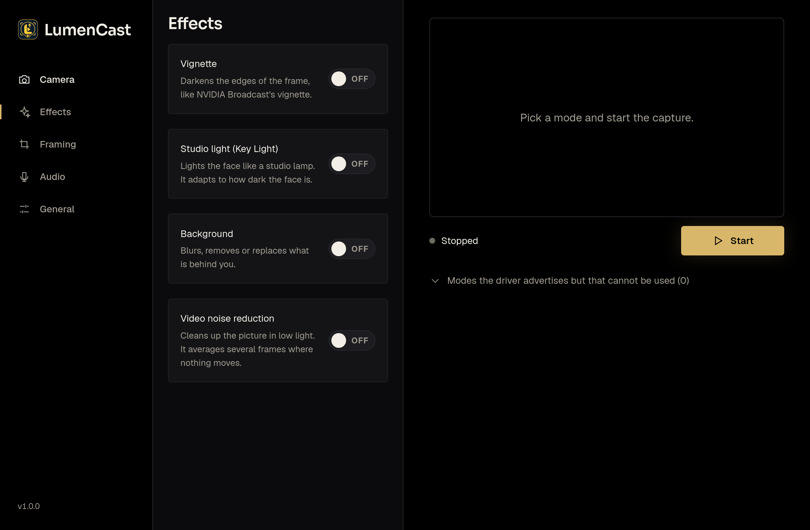
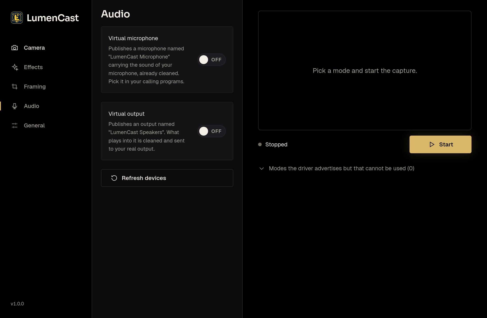
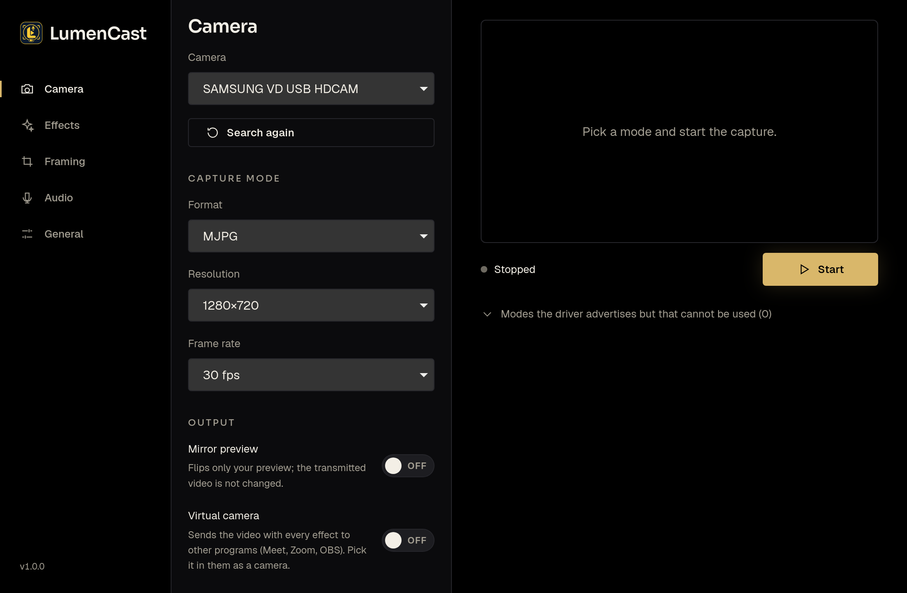

<div align="center">


# LumenCast

Webcam effects, a virtual camera and clean audio for video calls on Linux.<br>
Built with Rust, Tauri 2 and Svelte 5.

[](LICENSE)
[](https://github.com/MAlexVR/LumenCast/releases)
[](#requirements)



</div>

LumenCast sits between your camera and microphone and the programs you call
with (Meet, Zoom, Teams, OBS...). It cleans up the picture and the sound and
publishes the result as a **virtual camera** and a **virtual microphone** that
those programs can pick like any other device. It is the successor of
[Blucast](https://github.com/MAlexVR/Blucast): the same idea, rewritten as a small
native program that no longer needs a 7 GB container for its everyday effects.

- [Features](#features)
- [Requirements](#requirements)
- [Install](#install)
- [Using it](#using-it)
- [The NVIDIA background model (optional)](#the-nvidia-background-model-optional)
- [Tray, autostart and updates](#tray-autostart-and-updates)
- [Where things are stored](#where-things-are-stored)
- [Building from source](#building-from-source)
- [Releasing](#releasing)
- [Uninstalling](#uninstalling)
- [Troubleshooting](#troubleshooting)
- [Versioning](#versioning)
- [Credits and license](#credits-and-license)

## Features

**Video**

| Effect | What it does |
| --- | --- |
| Background | Blur, remove or replace what is behind you. Built-in model on the CPU, or NVIDIA's own model on the GPU (optional). |
| Studio light | A key light on your face that adapts to how dark it is, with warmth and strength, and an optional *light picture* (HDR) that decides where the light comes from and its colour. |
| Auto framing | Follows your face by moving the frame, at the zoom you choose; steady, with a dead zone so it does not tremble. |
| Video noise reduction | Cleans the picture in low light by averaging frames where nothing moves. |
| Vignette | Darkens the edges, optionally centred on your face. |
| Manual zoom, pan and mirror | The mirror flips only your own preview, never what is sent. |
| Virtual camera | Sends the processed video to a v4l2loopback device, optionally scaled up with a Lanczos filter. |

Cameras can be used in MJPG, YUYV and H264 (through the system's OpenH264).

**Audio** (PipeWire)

| Effect | What it does |
| --- | --- |
| Noise removal | RNNoise based, with a strength setting. |
| Room echo removal | Reduces the reverberation of a bare room. |
| Studio voice | Equalisation by microphone type (headset, laptop, desk), compression and a limiter. |
| Virtual microphone | "LumenCast Microphone", with your cleaned voice. |
| Virtual output | "LumenCast Speakers": what plays into it is cleaned and sent to your real output. |

**The program**

- Lives in the system tray: closing the window keeps the camera, the virtual
  camera and the audio running.
- Starts with your session, minimised to the tray.
- Checks for new versions on GitHub and installs them itself, verifying a
  checksum and a signature first.
- Spanish and English.

<p align="center">
  
  
</p>

## Requirements

- Linux with a desktop session (X11 or Wayland), `webkit2gtk-4.1` and GTK 3.
- **PipeWire** with its command line tools (`pipewire-utils` on Fedora,
  `pipewire-bin` on Debian and Ubuntu) for the audio features.
- **v4l2loopback** (kernel module) for the virtual camera.
- `openh264` for H264 cameras (optional).
- `polkit` for installing updates from inside the program (optional).
- For the NVIDIA background model only: an NVIDIA GPU with its driver,
  `podman` and the NVIDIA Container Toolkit with a generated CDI spec.

The package asks for the first two and recommends the rest.

## Install

Download the installer for your system from the
[Releases](https://github.com/MAlexVR/LumenCast/releases) page.

**Fedora and other RPM based systems**

```sh
sudo dnf install ./LumenCast-1.0.0-1.x86_64.rpm
```

**Debian, Ubuntu and other DEB based systems**

```sh
sudo apt install ./LumenCast_1.0.0_amd64.deb
```

The package installs the program, its icons and menu entry, and the
configuration that loads `v4l2loopback` with a device named *LumenCast Virtual
Camera* (`/dev/video10`) at boot. To use it right away, without rebooting:

```sh
sudo modprobe v4l2loopback devices=1 video_nr=10 card_label="LumenCast Virtual Camera" exclusive_caps=1 max_buffers=2 max_openers=10
```

If v4l2loopback is not installed: `sudo dnf install v4l2loopback` (Fedora, from
RPM Fusion) or `sudo apt install v4l2loopback-dkms`.

Then open **LumenCast** from your applications menu.

> [!NOTE]
> The package conflicts with the old `blucast` RPM, since both configure the
> same kernel module. Remove Blucast first if you installed it as a package.

## Using it

1. **Camera**: pick the camera, the format, the size and the frame rate, then
   press *Start*. The panel shows what the driver really granted.
2. **Effects**, **Framing**: switch on what you want. Changes apply while the
   camera runs.
3. **Camera → Output**: turn on *Virtual camera*, then choose
   *LumenCast Virtual Camera* in your calling program.
4. **Audio**: turn on the *Virtual microphone* (and, if you want, the virtual
   output), choose your real devices and the effects, and pick
   *LumenCast Microphone* in your calling program.
5. **General**: language, autostart, tray behaviour, updates.

## The NVIDIA background model (optional)

The built-in background model works anywhere. If you have an NVIDIA GPU you can
also use NVIDIA's own model, the one behind NVIDIA Broadcast, which cuts out
hair and edges better. It runs in a container that you build from your own
Blucast image (LumenCast ships none of NVIDIA's code or models):

```sh
podman pull ghcr.io/andrei9383/blucast:latest
sidecar/nvidia-matte/build.sh
```

Then choose *NVIDIA (GPU)* as the background model in *Effects*. While the
container is not ready the built-in model takes over, and the panel says why.
See [sidecar/nvidia-matte/README.md](sidecar/nvidia-matte/README.md).

## Tray, autostart and updates

- **Tray**: closing the window hides it; the tray menu shows or hides it,
  toggles the virtual camera and the autostart, looks for updates and quits.
  GNOME needs the *AppIndicator* extension to show tray icons; without it,
  turn off *Keep running in the tray when closed* in General.
- **Autostart**: starts LumenCast minimised to the tray when you log in.
- **Updates**: General → Updates. The program asks GitHub for the newest
  release, downloads the installer for how it is installed (RPM, DEB or
  AppImage), checks its SHA-256 and its minisign signature against the key
  built into the program, and only then installs it with `pkexec`. Nothing is
  installed if either check fails. A private repository needs an access token
  in `~/.config/lumencast/update-token`.

## Where things are stored

| What | Where |
| --- | --- |
| Settings | `~/.config/lumencast/settings.json` |
| Autostart entry | `~/.config/autostart/lumencast.desktop` |
| Update token (optional) | `~/.config/lumencast/update-token` |

The first run imports what it can from Blucast's `~/.config/blucast/settings.json`
and tells you what it did.

## Building from source

You need Rust (the exact version is pinned in `rust-toolchain.toml`), Node.js
with `pnpm`, and the development packages of WebKitGTK 4.1, GTK 3 and
libayatana-appindicator (`webkit2gtk4.1-devel gtk3-devel libappindicator-gtk3-devel`
on Fedora; `libwebkit2gtk-4.1-dev libgtk-3-dev libayatana-appindicator3-dev` on
Debian and Ubuntu), plus `libopenh264` at run time for H264.

```sh
pnpm install                      # once
pnpm --dir ui install
pnpm tauri build --debug --no-bundle   # a quick build: target/debug/lumencast
pnpm tauri build                       # release packages in target/release/bundle
```

Run the debug build with `WEBKIT_DISABLE_COMPOSITING_MODE=1 ./target/debug/lumencast`
if your GPU driver makes WebKitGTK draw a blank window.

Checks, the same ones used before every commit:

```sh
cargo fmt --all --check
cargo clippy --workspace --all-targets -- -D warnings
cargo test --workspace
pnpm --dir ui check && pnpm --dir ui test
```

Tests that need hardware (a camera, PipeWire, a GPU) are marked `#[ignore]`;
each one says in its header how to run it.

The layout:

| Path | What |
| --- | --- |
| `crates/lumencast-core` | Camera modes and the capture session, with no I/O |
| `crates/lumencast-v4l` | V4L2 capture and the loopback writer |
| `crates/lumencast-fx` | The picture stages: zoom, light, background, noise, vignette |
| `crates/lumencast-vision` | Face detection |
| `crates/lumencast-segment` | The built-in person segmentation model |
| `crates/lumencast-nvidia` | The client of the optional NVIDIA container |
| `crates/lumencast-h264` | H264 decoding through the system OpenH264 |
| `crates/lumencast-audio` | Noise removal, room echo removal, studio voice |
| `crates/lumencast-update` | Finding, verifying and installing a new version |
| `crates/lumencast-app` | The application core, tested without a window |
| `src-tauri` | The thin Tauri layer: commands, tray |
| `ui` | The Svelte interface |

## Releasing

1. `scripts/set-version.sh X.Y.Z` and add the entry to `CHANGELOG.md`.
2. Run the checks above, then `pnpm tauri build`.
3. `scripts/release.sh` signs the packages with your update key, writes
   `SHA256SUMS.txt` and prints the `gh release create` command.

The signing key is created once with `pnpm tauri signer generate` and lives
outside the repository (`~/.config/lumencast-release/update.key`); its public
half is in `crates/lumencast-update/update.pub`. Losing the private key means
installed programs can no longer verify updates.

## Uninstalling

```sh
sudo dnf remove lumen-cast        # or: sudo apt remove lumen-cast
rm -rf ~/.config/lumencast ~/.config/autostart/lumencast.desktop
```

## Troubleshooting

- **No virtual camera in my call program.** Check `ls /dev/video*` and
  `v4l2-ctl --list-devices`: a *LumenCast Virtual Camera* must be there. If not,
  load the module (see [Install](#install)). Switch on *Virtual camera* in the
  Camera tab, and start the capture.
- **The window is blank.** Start it with `WEBKIT_DISABLE_COMPOSITING_MODE=1`.
- **The camera shows fewer frames per second in dim light.** The camera itself
  lowers its rate when exposure is automatic: `v4l2-ctl -d /dev/videoN
  --set-ctrl=exposure_dynamic_framerate=0`.
- **H264 shows nothing.** Install OpenH264 (`sudo dnf install openh264`).
  Some cameras only offer H264 up to 640x480.
- **No audio devices.** The audio features need PipeWire and its tools:
  `pw-cat --version` must work.
- **The tray icon does not appear (GNOME).** Install the *AppIndicator and
  KStatusNotifierItem Support* extension, or turn off *Keep running in the tray
  when closed*.
- **The NVIDIA model says it is not ready.** `podman ps` must list
  `lumencast-matte`; check `nvidia-smi` and that the CDI spec exists
  (`sudo nvidia-ctk cdi generate`).

## Versioning

LumenCast follows [Semantic Versioning](https://semver.org/). The version lives
in `Cargo.toml` (`[workspace.package]`), `package.json`, `ui/package.json` and
`src-tauri/tauri.conf.json`; `scripts/set-version.sh` keeps them equal. Every
release is a `vX.Y.Z` tag and has an entry in the [CHANGELOG](CHANGELOG.md).

## Credits and license

LumenCast is MIT licensed, see [LICENSE](LICENSE). It started as a rewrite of
[Blucast](https://github.com/Andrei9383/Blucast) by Andrei9383 (also MIT), and
keeps its copyright notice; the code in this repository was written for
LumenCast. Third party models, libraries and fonts, with their licenses, are
listed in [THIRD_PARTY.md](THIRD_PARTY.md), and their license texts are in
[licenses/](licenses/). "NVIDIA", "Maxine" and "NVIDIA Broadcast" are
trademarks of NVIDIA Corporation; LumenCast is not affiliated with or endorsed
by NVIDIA, and does not contain or redistribute any NVIDIA code or model.
